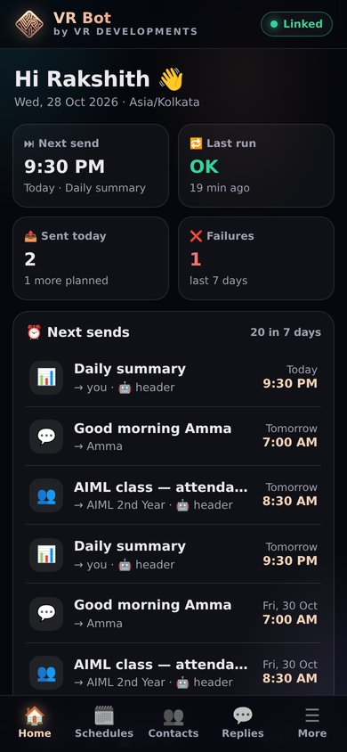
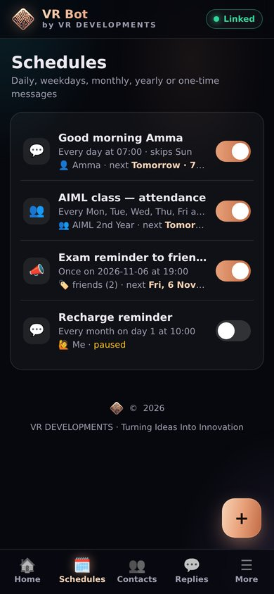
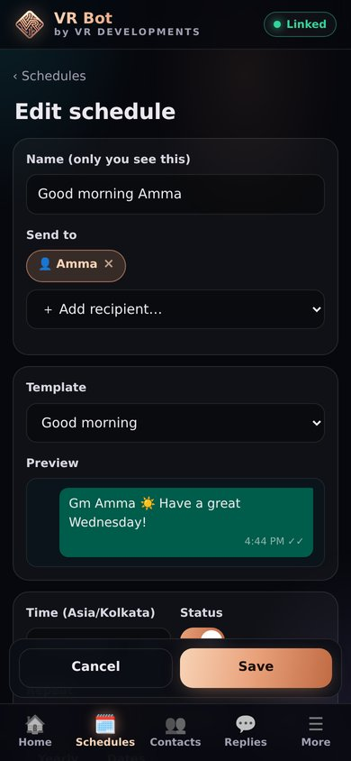

<p align="center">
  
</p>

<h1 align="center">VR Bot</h1>
<p align="center"><b>by VR DEVELOPMENTS</b> · <i>Turning Ideas Into Innovation</i></p>
<p align="center">Free WhatsApp automation that runs entirely on GitHub — no server, no credit card, no phone left on charge.<br>
GitHub Actions does the work · GitHub Pages hosts your phone control panel.</p>

---

## ✨ What it does

| | Feature | Timing |
|---|---|---|
| 🗓️ | **Scheduled messages** — once, daily, chosen weekdays, monthly, yearly, chosen dates · skip days · skip dates · date ranges | **Exact minute** |
| 🎂 | **Birthday wishes** from your contacts' birthdays, at the time you choose (00:00 = midnight) | **Exact minute** |
| 🪔 | **Festival wishes** — built-in Indian calendar 2026–2027 (Diwali, Sankranti, Ugadi, Holi, Eid, Dussehra, Ganesh Chaturthi, Christmas, New Year, Republic/Independence Day…), per-festival lists & messages | **Exact minute** |
| 👥 | **Group message scheduler** — class reminders, exam dates | **Exact minute** |
| 📣 | **Lists / broadcast** — one message to a tag (family, friends…) with random gaps + daily cap | Starts on the minute, then 8–20 s gaps |
| 📝 | **Templates** — `{name}` `{first_name}` `{date}` `{day}` `{time}` `{festival}` `{age}` `{my_name}` + random `{{Hi\|Hello}}` | — |
| 🧍 | **Human-like delay** — optional ±N minutes per schedule (off by default) | ± your choice |
| 🤖 | **"VR Bot is sending" header** — optional first line, on by default for groups/lists/alerts, off for personal wishes; per schedule & per contact override | — |
| ↩️ | **"No reply" follow-up** after X days for chosen people | Exact minute |
| 📊 | **Daily summary** to you — who messaged, today's sends, failures, tomorrow | Exact minute |
| 🗓️ | **Weekly report** to you (Sunday 8 PM by default) — top people, busiest groups, vs last week, busiest hour. Counts only, never message text | Exact minute |
| 📸 | **Auto status** — posts a WhatsApp text status (built-in motivational quotes with no repeats, AI-fresh lines, your own texts, or a photo link) on chosen days at a set time, to all / only these / all except these. Off by default | Exact minute |
| 🎉 | **Special days** — on festivals and special days (Sankranti, Ugadi, Eid, Bathukamma, Diwali, Independence Day, Teachers' Day, World Savings Day… 33 days, exact dates for 2026–2027) the auto status is a ready-made picture card with a caption instead of the quote. Turn any day off or change its caption; still one status a day. On whenever Auto status is on | Exact minute |
| 🔕 | **Busy mode** — `!busy 2h`, `!busy until 5pm`, `!busy off` or the panel switch: "VR's busy, back by 5:00 PM 🙏" once per chat, **only in the chats/groups you pick**; turns off by itself and tells you | Within seconds (Always on) |
| 🎓 | **Class mode** — `!class 2h`, `!class till 4`, `!class` (1 hour) or the panel switch: "in class rn, will text after 4" once per chat, same chats as busy mode (or your own pick). Only one of busy/class is on at a time; `!free` turns off either | Within seconds (Always on) |
| 🧸 | **Stickers & GIFs ignored** — auto-replies, AI, away and busy never react to stickers, GIFs, reactions, deleted messages or polls (switch in Replies) | — |
| 🔔 | **Alerts to you** — GitHub stars/forks/issues/PRs + website contact form | Within seconds (Always on) |
| ⚡ | **Auto-reply rules** — whole words / contains / exact / starts-with / regex, global or per tag, cooldown | Within seconds (Always on) |
| 🎙️ | **Your own voice notes** — record or upload clips (panel) or `!voice save` in WhatsApp; a keyword rule or a schedule sends one as a real voice note | Within seconds (Always on) |
| 🧠 | **AI replies in your style** (Groq free API) — style prompt + example chats + memory | ⏱ Next check |
| 🌙 | **Away mode** — message + optional night window, `!away` / `!back` from WhatsApp | ⏱ Next check |
| 🛡️ | **Group tools** — welcome & goodbye, warns → auto-kick, anti-spam, bad-word filter, slow mode, night lock, anti-link (off by default), `!tagall`, `!rules`, `!report` | ⏱ Next check |
| ⌨️ | **Commands** — `!sticker` `!pdf` `!weather` `!help` `!yt` (experimental) | ⏱ Next check |
| 📝 | **Notes** — `!note buy charger`, or reply `!note` to any message, link or forward to save it (with who sent it). `!notes` lists the last 10, `!note delete 3` removes one. Panel → More → 📝 Notes: search, open links, copy, delete, add | Within seconds (Always on) |
| 🎨 | **Panel looks** — More → 🎨 Appearance: Classic, Glassmorphism, Neumorphism, Claymorphism, Neo-Brutalism, Bento Grid, Skeuomorphism, Aurora, Retro Windows / Mac OS, Isometric, Kinetic type; light/dark where it fits. Saved on each phone | Instantly |
| 🎤 | **Voice note → text** (Groq Whisper, free) | ⏱ Next check |
| 💾 | **Save incoming media / statuses** (small files, encrypted) | ⏱ Next check |

Every feature has an on/off switch in the panel. Failures are sent to your own WhatsApp.

> **"Always on" — please read.** GitHub Actions is not a server, so the bot keeps itself alive: each run stays connected for ~80 minutes and starts the next run before it ends (Settings → Timing → **Always on**, on by default). Scheduled messages go out **on the exact minute**, and replies to incoming messages (auto-reply, AI, away, commands, group tools) happen **within seconds** — except for a short ~1–2 min hand-over gap about every 80 minutes (messages that arrive then are answered when the next run connects). Rows marked "⏱ Next check" above are near-instant with Always on. With Always on switched off (or while paused), the bot only wakes when GitHub's timer fires, which can be late by hours on a quiet repo.

## 📱 The control panel

Your panel lives at `https://<your-username>.github.io/vr-bot/` — install it on your phone like an app.

<p align="center">  </p>
<p align="center"><sub>Demo data. Open your panel and tap “Try the demo” to click around before setup.</sub></p>

Dashboard (next sends, last run, failures) · Schedules (create / edit / pause / test / send now) · Contacts (birthdays, tags, paste-import) · Replies (rules, away, AI) · Festivals · Templates · Group tools · Settings · Logs (sent, runs, bot log, saved media).

## 🚀 Setup

**Follow [SETUP.md](SETUP.md)** — 12 numbered steps, about 20 minutes, no coding.

## ⏱️ How exact is "exact"?

- A run is **always connected** and **sends at hh:mm:00** (usually within a few seconds).
- Each run lives ~80 min, then **starts the next run itself** (it never hands over when a send is due in the next 6 minutes). GitHub lets only one run hold the WhatsApp connection and keeps at most one waiting, so runs never pile up. You don't depend on GitHub's timer at all.
- A small **Watchdog** workflow (every ~20 min, best-effort) restarts the chain if it ever stops (e.g. GitHub outage).
- Every send is recorded in an encrypted **sent-log** (the dedupe ledger), so a message is **never sent twice** and a run that starts late still sends what was missed (up to 3 hours late by default, marked "late" in Logs).
- GitHub's own docs say scheduled runs "can be delayed during periods of high loads" and that "some queued jobs may be dropped". That's why the bot no longer relies on the timer: the always-on chain + watchdog + catch-up make a late message rare, but during a GitHub outage a message can be late. You'll see it in Logs and in your daily summary.
- Lists send one by one with 8–20 s gaps (safer for your number), so the 50th person gets it a few minutes after the first.

## 🔐 Privacy & security (your repo is public)

GitHub Pages is free only for **public** repos, and Actions minutes are free and unlimited only for public repos — so the repo is public, and **everything private is encrypted**:

- Contacts, schedules, messages, settings, the WhatsApp session, logs and saved media are encrypted with **AES-256-GCM**, key from your password (`VR_PASSPHRASE`, PBKDF2-SHA256 200k rounds). Without the password they are random bytes.
- The panel encrypts in your browser before saving. Your GitHub token stays in your phone's browser storage only.
- **Actions logs are public**, so the bot never prints phone numbers (only `+91******979`), names or message text. Detailed logs are encrypted and shown only in your panel.
- The example data shipped in `data/` is fake and marked `"example": true` (never sent). Once you save from the panel, those files become encrypted.

## 🗄️ Where things are stored

| What | Where | Why |
|---|---|---|
| Your settings, contacts, schedules… | `data/*.json` on `main` (encrypted) | The panel edits them through the GitHub API |
| WhatsApp session, sent-log, logs, memory | `vr-state` branch (encrypted, one commit, force-pushed each run) | Never expires (Actions cache/artifacts do), atomic, panel can read it, repo doesn't grow. The previous session is kept as `session.prev.json` |
| Saved media | `vr-media` branch (encrypted, ≤ 3 MB per file, 300 MB total, oldest dropped) | Runners are wiped after every run |
| Notes | `vr-notes` branch (one encrypted file per note) | `vr-state` is rewritten by every run, so a note the panel adds there could be wiped; one file per note lets the panel and the bot save at the same moment |
| Voice clips | `vr-voice` branch (encrypted audio + encrypted name, ≤ 60 s / 1 MB each) | Panel and bot both add clips there without touching `main`, so your repo stays small and no edit conflicts |

## ⌨️ Commands (in WhatsApp)

Everyone (switchable): `!help` · `!weather Hyderabad` · `!sticker` (on/reply to an image or short video) · `!pdf` (send images, then `!pdf`) · `!yt <link>` (experimental, off) · in groups: `!tagall <msg>` (admins) · `!rules` · `!report` (reply to a message; groups where you're admin)
Only you (from your own phone or "Message yourself"): `!away <msg>` · `!back` · `!pause` · `!resume` · `!status` · `!text` (reply to a voice note) · `!busy 2h` / `!busy 30m` / `!busy until 5pm` / `!busy off` · `!class 2h` / `!class till 4` / `!class` (1 hour) · `!free` (ends busy or class) · `!voice save <name>` (reply to a voice note) / `!voice list` / `!voice play <name>` / `!voice delete <name>` · `!note <text>` (or reply `!note` to any message) / `!notes` / `!notes <word>` / `!note delete <n>`
Group admin, only you, typed inside a group where your number is admin (otherwise: "I need admin in this group for that"): `!kick @user` (or reply) · `!add 91XXXXXXXXXX` · `!mute` / `!mute 30m` / `!mute 2h` / `!unmute` · `!del` (reply) · `!warn @user` / `!warns @user` / `!unwarn @user` (kick at "Warns before kick", per group) · `!link` / `!resetlink` · `!setname <name>` / `!setdesc <text>` · `!lock 23:00-07:00` / `!lock off` · `!slow 30` / `!slow off` · `!pin` (reply; `24h` / `7d` / `30d`) / `!unpin` · `!poll Question | a | b` · `!summary` / `!summary 100` / `!summary here`

## 🔔 Website contact form → WhatsApp

1. Panel → Settings → Alerts → **Website contact form** on → **Generate** a topic → Save.
2. In your website's form submit code:

```js
fetch('https://ntfy.sh/YOUR-TOPIC', { method: 'POST', body: `Name: ${name}\nEmail: ${email}\n\n${message}` });
```

[ntfy.sh](https://ntfy.sh) is free and needs no account; it keeps messages 12 hours and the bot checks every 30 minutes. Anyone who knows the topic can post to it or read it, so keep the topic random and don't send secrets through it.
For your own scripts you can also trigger an alert with a GitHub token: `POST /repos/<you>/vr-bot/dispatches` with `{"event_type":"vr-alert","client_payload":{"text":"Server is down!"}}` (never put a token in public website code).

## ⚠️ Honest limitations

- **Unofficial client.** Baileys connects as a "linked device" (like WhatsApp Web). It is not the official WhatsApp API. WhatsApp can ban numbers that spam — especially bulk messages to people who haven't saved your number. Keep lists small, use the daily cap, and use a spare number if you can.
- **Replies are delayed** (up to ~30 min) — see above.
- **Linked devices log out if your phone doesn't use WhatsApp for 14 days** (WhatsApp's rule). Open WhatsApp on the phone at least once every two weeks. If WhatsApp ever logs the bot out, the panel shows a red banner and you run "Pair WhatsApp" again (2 minutes).
- **GitHub's terms:** GitHub says Actions should not be used for things unrelated to the software project in the repo, or for heavy "serverless app" use. VR Bot is your own project and stays low-load (short runs, mostly sleeping), but it is a grey area — GitHub could slow down or disable Actions on the repo. Don't run copies for other people.
- **Scheduled workflows in public repos stop after 60 days without activity.** The bot commits a small heartbeat every 20 days to prevent this.
- **Auto status** is posted by an unofficial client. WhatsApp may treat frequent automated statuses to many people as spam, so keep it to once a day, keep the audience to people who know you, and start with "Post test status now". Statuses go only to the people in the list the bot sends (your Contacts tab, optionally people who texted you in the last 30 days), capped at 500.
- **Did the status really go up?** WhatsApp can silently refuse a status from a linked device (a known bug in the WhatsApp library, Baileys 7: the post "succeeds" but nothing shows). VR Bot now waits for WhatsApp's own answer, tries the other ways of addressing the post if it is refused (a refused try shows nowhere, so no doubles), remembers the way that worked, and sends pictures as real JPEG. After "Post test status now" the bot messages you **ACCEPTED** or **REJECTED**; the panel log shows the same. Want to check that others see it too? Pick one friend under Try it → "Test also goes to".
- **Special days** use the same audience and the same one-status-a-day limit. The picture cards live in `panel/days/` (no extra download at run time). If a picture can't be posted, the caption goes out as a text status instead. Eid dates depend on the moon and can move by a day; turn the day off in the panel if your area celebrates on a different day.
- **`!yt`**: YouTube often blocks GitHub's servers ("confirm you're not a bot") — experimental.
- **Saved media/statuses**: only what arrives while the bot is connected or in the backlog it receives on connect; small files only.
- **Festival dates** for lunar festivals (and Eid, which depends on moon sighting) must be checked every January (Panel → Festivals → tap → edit date).
- **Bad MAC / "waiting for this message"**: if a run crashes before saving, encryption keys can get out of sync for a few messages. The bot saves after every run (even on errors) and every 10 minutes while waiting to keep this rare.

## 🧰 For developers

```bash
npm install
npm test              # scheduler, templates, rules, crypto, planner, end-to-end dry run
npm run check         # node --check on every file
VR_PASSPHRASE=x node src/index.js plan 14     # preview the next 14 days of sends
VR_FAKE_WA=1 VR_PASSPHRASE=x VR_NO_PUSH=1 node src/index.js run   # dry run, no WhatsApp
```

`src/` — the bot (Node 22, ESM). `panel/` — the static PWA. `panel/shared/` — pure modules used by both (scheduler, planner, templates, rules, crypto, festivals). Built with [Baileys](https://github.com/WhiskeySockets/Baileys) 7, sharp, pdf-lib, Open-Meteo, Groq.

---

<p align="center"><br><b>© 2026 VR DEVELOPMENTS</b> · <a href="https://github.com/Volam-Rakshith">github.com/Volam-Rakshith</a> · <a href="https://vrdevelopments.sites.tab.bot">vrdevelopments.sites.tab.bot</a><br>MIT licensed code · VR DEVELOPMENTS name & logo © VR DEVELOPMENTS</p>
